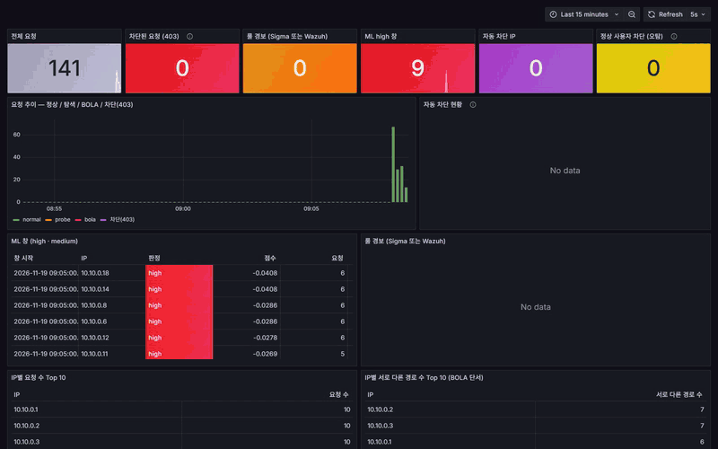
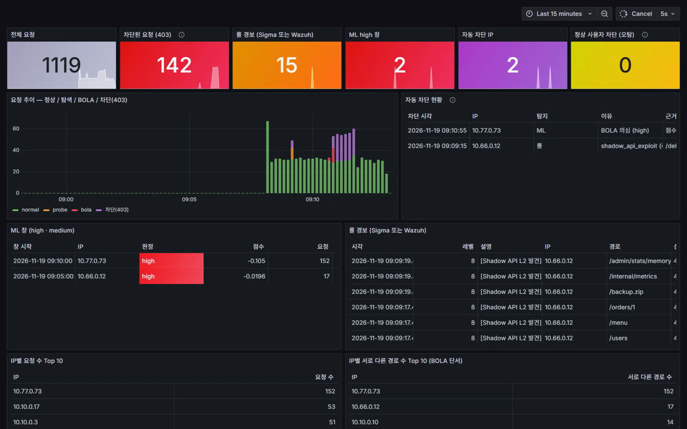
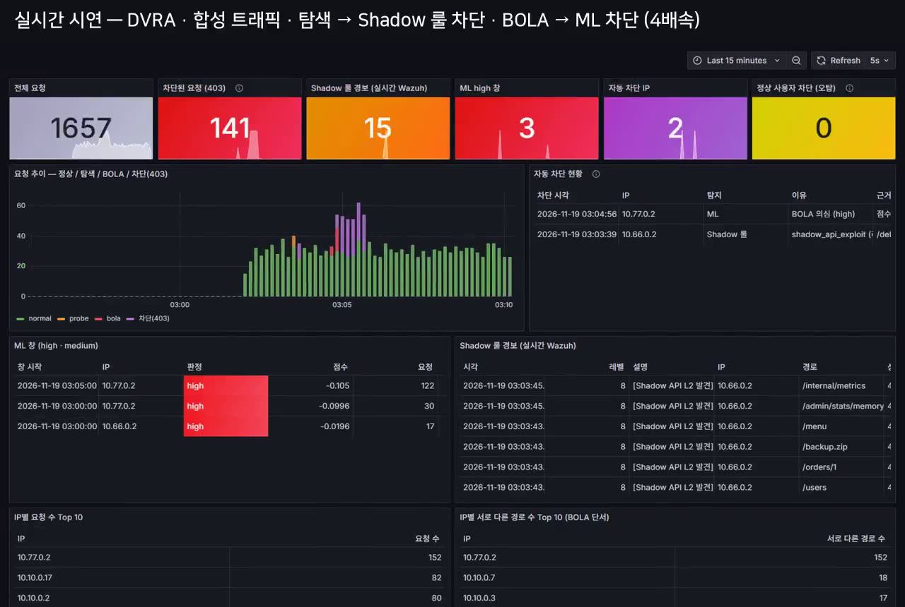
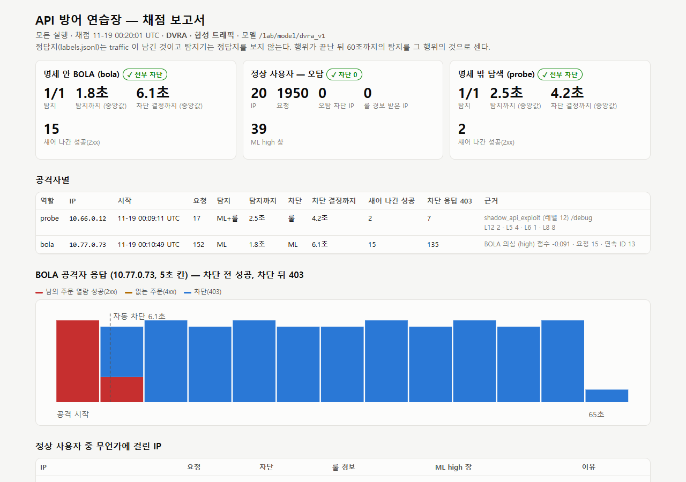

# api-defense-lab — API 방어 연습장

[](https://github.com/zeldaim/api-defense-lab/actions/workflows/detection-ci.yml) [](https://github.com/zeldaim/api-defense-lab/actions/workflows/release-image.yml) [](https://scorecard.dev/viewer/?uri=github.com/zeldaim/api-defense-lab)

> **A reproducible practice range for API *defenders*.**  
> Attack ranges (crAPI, DVRA) are common. A range where *defenders* score their own rules and models under identical conditions is not. → [Help test it](#help-test-api-defense-lab)
>
> **What's included:** vulnerable API (DVRA) · nginx logging & blocking · Sigma rules (shadow API) · ML detector (BOLA) · automatic blocking · answer key · scorer  
> **Optional modules:** `wazuh` (SIEM rule authoring) · `dashboard` (Elasticsearch + Grafana)  
> **Traffic is synthetic. This is a lab, not a security product.**
>
> **For authorized use only.** DVRA is a deliberately vulnerable app; every port binds to `127.0.0.1` only (never expose this to the internet). Run it only in your own environment, against your own machine, for learning and testing your own detection — never against a target you don't own or control.
>
> **Default setup results** (Windows 11 + Docker Desktop, 2026-11-19):
>
> | Scenario | Detection | Blocked in |
> |----------|-----------|-----------|
> | Shadow API probe | Sigma rule (L3) | **2.3 s** (core) / **3.2 s** (Wazuh) |
> | In-spec BOLA | ML detector | **6.5–6.9 s** (after 17–18 leaked orders) |
> | 20 normal users | — | **0 blocked** (false positive) |
>
> **Quick start** (Docker Compose v2.20+, ~1.8 GB images, ~220 MB RAM):
> ```bash
> git clone https://github.com/zeldaim/api-defense-lab.git && cd api-defense-lab
> docker compose up -d --build           # core; add --profile wazuh / --profile dashboard for modules
> docker compose run --rm traffic demo   # 20 normal users + shadow-API probe + BOLA enumeration (~10 min)
> docker compose run --rm scorer         # score table + reports/report.html
> ```
>
> **Start here.** This repo is the runnable entry point of a larger API-security body of work — see the [project map](#프로젝트-지도--이-레포의-위치) below.

## 프로젝트 지도 — 이 레포의 위치

**한 줄로:** 명세가 없어도 API 를 찾아내고(발견) → 승인된 API 목록을 표준 형식으로 만들고(표준화) → 그 목록 밖 호출은 룰로, 목록 안 이상 행위는 ML 로 잡아 막고(탐지 · 차단) → 정답지로 몇 개를 몇 초 만에 막았는지 잰다(평가).
이 레포는 그 흐름을 **`docker compose up` 한 번으로 직접 돌려 보는 곳**이다. 설계 · 근거 · 다른 앱 검증은 아래 저장소에 있다.

| 단계 | 저장소 | 들어 있는 것 | 이 레포와의 관계 |
|---|---|---|---|
| 발견 | [shadow-api-lab](https://github.com/zeldaim/shadow-api-lab) | 명세 · 능동 스캔 · 트래픽 미러링(Zeek)을 합쳐 Shadow · Zombie API 판정 (OWASP API9) | 같은 생각을 이 레포는 `inventory` 모듈(mitmproxy)로 — [docs/inventory.md](docs/inventory.md) |
| 표준화 · 자동화 | [api-security-supply-chain](https://github.com/zeldaim/api-security-supply-chain) | CycloneDX API-BOM · SBOM · VEX, 명세에서 Wazuh 룰 생성, Ansible 자동 대응, crAPI 에서 다시 검증, 이미지 서명 차단 시연 | 이 레포의 Shadow API 룰 생성기와 배경. 그쪽은 **설계 · 검증 기록**, 이쪽은 **돌아가는 연습장** |
| 탐지 (ML) | [ml_detection](https://github.com/zeldaim/ml_detection) | 룰이 놓친 이상 행위(BOLA · 느린 공격)를 비지도 ML 로 — 실제 랩 로그 평가와 스스로 정정한 오탐 수치 | 이 레포의 BOLA 탐지 모델(IP × 5분 창 특징)의 출발점 |
| 외부 기여 | [anchore/grype-db #1187](https://github.com/anchore/grype-db/pull/1187) | 취약점 DB 빌드에서 잘못된 provider 이름이 조용히 무시되던 버그 수정 (리뷰 대기) | 공급망 도구 쪽 기여 |

**처음 보는 사람은:** ① 아래 [빠른 시작](#빠른-시작)으로 한 번 돌려 보고 → ② [채점](#채점) 표를 보고 → ③ [알려 둘 한계](#알려-둘-한계)를 읽는다. 내 룰 · 모델을 넣어 보려면 [내 모델로 채점받기](#내-모델로-채점받기-ml)와 그 위 두 절.

공격 연습장(crAPI · DVRA)은 많은데, **방어하는 쪽이 자기 룰 · 모델을 같은 조건에서 채점해 볼 곳**은 드물다. 그래서 이 레포를 만들었다.

- **코어**(가벼움, 이미지 약 1.8GB · 메모리 약 220MB)만으로 대상 앱 · 기록 · 룰 탐지 · ML 탐지 · 자동 차단 · 정답지 · 채점이 다 된다.
- 하는 일에 맞춰 **모듈**을 켠다: Wazuh 룰을 연습하면 `wazuh`, 관제 화면이 필요하면 `dashboard`.
- 정상 사용자와 공격을 보내면 **정답지(누가 공격자인지)** 가 자동으로 쌓이고, 채점기가 **몇 개를 잡았나 · 몇 초 만에 막았나 · 정상을 몇 명 막았나** 를 표로 보여 준다.
- 내 Sigma 룰 · 내 Wazuh 룰 · 내 ML 모델을 넣고 같은 채점을 받을 수 있다.



**Wazuh + 대시보드 모듈 풀 구성에서 `traffic demo` 실행 중 공격 구간 (8배속). Shadow API 탐색은 Sigma 룰(L3)로, BOLA는 ML 탐지기로 자동 차단. 정상 사용자 20명은 차단 없음. 전체 영상은 아래 "영상".**  
<sub>(`docker compose --profile wazuh --profile dashboard up` → `traffic demo` 중 공격 구간. 시작 직후 정상 사용자 창이 ML high 로 떠도 차단 정책이 걸러 차단 0, 탐색은 룰 L3 로 · BOLA 는 ML 로 막힌다.)</sub>

> ⚠️ 트래픽은 생성기가 만든 **합성**이다. 대상 앱 DVRA 는 **일부러 취약한 앱**이다 — 모든 포트는 `127.0.0.1` 에만 연다. 인터넷에 노출하지 말 것.

## 영상

| | |
|---|---|
| [](docs/media/demo_2026-11-19_4x.mp4) | **이 레포 데모 (2026-11-19, 4배속, 3분 3초).** Wazuh + Grafana 대시보드 풀 구성에서 새 clone 직후 바로 실행한 화면. Shadow API 탐색 차단: **4.2초** (차단 전 2회 성공) · BOLA 차단: **6.1초** (차단 전 남의 주문 15건 노출) · 정상 사용자 20명 오탐: **0건** <sub>(새 clone 에서 `--profile wazuh --profile dashboard up` → `traffic demo` 를 Grafana 화면으로 녹화. ML high 창 39 — 차단 정책이 걸렀다.)</sub> |
| [](docs/media/prototype_demo_2026-11-19_4x.mp4) | **프로토타입 시연 (2026-11-19, 4배속, 2분 33초) — 이 레포의 바탕.** Shadow API 탐색 차단: **2.9초** · BOLA 차단: **8.2초** · 정상 사용자 차단: **0건**. 현재 레포와 구성이 다름 (채점기·모듈 구조 없음, Wazuh 항상 켬). <sub>(정상 20명 사이로 명세 밖 탐색 → 실시간 Wazuh L3 → 자동 차단, 명세 안 BOLA → ML high → 자동 차단. 호스트 스크립트 · Wazuh 항상 켬 구성으로 찍었다 — 채점기 · 코어/모듈 구조 · `/docs` 오탐 수정은 영상에 없다.)</sub> |

## 코어와 모듈

| 업무 | 켜는 것 | 명령 | 추가 이미지 · 메모리 |
|---|---|---|---|
| 탐지 룰 작성 (Sigma) · ML 모델 · 차단 정책 · 채점 | **코어** | `docker compose up -d --build` | — (이미지 약 1.8GB · 메모리 약 220MB) |
| SIEM 룰 작성 (Wazuh) | 코어 + `wazuh` | `docker compose --profile wazuh up -d --build` | Wazuh 2.5GB · 약 350MB |
| 관제 · 대시보드 (실시간 차단 화면) | 코어 + `dashboard` | `docker compose --profile dashboard up -d --build` | ES 2.6GB + Grafana 0.9GB · 약 1.7GB (ES 힙 1GB) |
| 전부 (시연 · 비교) | 코어 + 둘 다 | `docker compose --profile wazuh --profile dashboard up -d --build` | 위 합 (이미지 약 7.8GB) |
| **명세 없이 시작** — 트래픽에서 API 인벤토리 → 공식 명세와 대조 → 룰 생성 | 코어 + `inventory` | `docker compose --profile inventory up -d --build` → [docs/inventory.md](docs/inventory.md) | mitmproxy + mitmproxy2swagger · 프록시를 거친 트래픽만 기록 |

- `detector` 는 켜진 모듈을 스스로 찾는다(30초마다): **`wazuh` 가 있으면 Wazuh 경보로, 없으면 `rules/sigma/*.yml` 을 직접 적용해** 룰 판정을 한다. 두 판정은 같은 접속 로그에서 줄 단위로 일치하게 맞춰 두었다(아래 결과). `dashboard` 가 있으면 ES 로도 보낸다.
- 모듈을 켜고 끈 뒤에도 정답지 · 채점 · 차단 정책은 그대로다 — 모듈은 **판정 엔진과 화면만** 바꾼다.
- `traffic` · `scorer` · `trainer` 는 어느 조합에서나 `docker compose run --rm <이름>` 으로 쓴다.
- 환경 변수 `COMPOSE_PROFILES=wazuh,dashboard` 를 `.env` 에 적어 두면 `--profile` 을 매번 안 써도 된다.

```
traffic(정상 · 공격 + 정답지) ──▶ nginx :8089 ──▶ DVRA (대상 앱)
                                   │ 접속 로그          ▲ 403 (차단 목록)
                                   ▼                    │
                   [코어] detector ── 룰 판정: Sigma(직접) 또는 [wazuh] Wazuh 경보
                                    ── ML 판정(IP × 5분 창) ── 차단 정책 ──┘
                                    ── events.jsonl ──▶ scorer: 정답지 × 판정 → 채점표 · reports/report.html
                                    ── [dashboard] Elasticsearch ──▶ Grafana :3000
```

| 서비스 | 묶음 | 하는 일 |
|---|---|---|
| `dvra-web` · `dvra-db` | 코어 | 대상 앱 [Damn Vulnerable RESTaurant](https://github.com/theowni/Damn-Vulnerable-RESTaurant-API-Game). 코드는 이 레포에 없다 — 고정 커밋 `d32d099` 을 GitHub 에서 직접 빌드. 원본 compose 의 `privileged` · `SYS_ADMIN` 은 주지 않는다 |
| `nginx` | 코어 | 접속 기록 + 차단 목록(`ips.map`)의 IP 는 403. 목록이 바뀌면 1초 안에 다시 읽는다 |
| `detector` | 코어 | 2초마다: 룰 판정(Sigma 또는 Wazuh 경보) · ML 채점 · 차단 정책 → 차단 목록 · events.jsonl (· ES) |
| `traffic` · `scorer` · `trainer` | 코어 도구 | 트래픽 + 정답지 · 채점 · 내 모델 학습 |
| `wazuh` | 모듈 `wazuh` | Wazuh manager 4.14.10 이 접속 로그를 실시간으로 읽어 `rules/wazuh/*.xml` 로 판정 |
| `elasticsearch` · `grafana` | 모듈 `dashboard` | 실시간 대시보드 http://localhost:3000 (로그인 없음, 5초 새로고침) |
| `inventory-proxy` · `inventory` | 모듈 `inventory` | 프록시가 트래픽을 기록 → mitmproxy2swagger 로 관측 명세 → 공식 명세와 대조(Shadow · 관측 안 됨) → `--sigma` 로 룰. 숨은 API 3/3 · 오탐 Shadow 0 (허용 목록 IP 탐색 기준), 관측 명세 룰은 정답 사례 18/19 — [docs/inventory.md](docs/inventory.md) |

## 준비물

- Docker Desktop(Windows · macOS) 또는 Docker Engine + **Compose v2.20 이상** (모듈이 꺼졌을 때 기다리지 않는 `depends_on.required: false` 를 쓴다)
- 디스크 · 메모리: 위 표. 전부 켜면 디스크 여유 **10GB** · 메모리 여유 **6GB** 이상
- 처음 한 번은 인터넷 (이미지 내려받기 + DVRA 를 GitHub 에서 빌드)

> **디스크 경고 (`wazuh` 모듈).** Wazuh manager 는 기본 설정이면 **취약점 탐지가 CVE 데이터를 내려받아 컨테이너가 몇 GB~16GB 로 커진다** (작성자 PC 에서 디스크가 가득 차 Docker 가 멈췄다). 이 연습장은 시작할 때 그 기능을 끈다(`wazuh/lab-init.sh`). 직접 Wazuh 설정을 바꿀 때 다시 켜지 않도록 주의.

## 빠른 시작

```bash
git clone https://github.com/zeldaim/api-defense-lab.git
cd api-defense-lab
docker compose up -d --build          # 코어만. 모듈은 위 표의 --profile 을 붙인다
docker compose ps                     # detector 가 Up, 나머지 (healthy) 면 준비 끝
```

```bash
docker compose run --rm traffic demo  # 정상 20명 + 60초 뒤 탐색 + 150초 뒤 BOLA (약 10분)
docker compose run --rm scorer        # 채점표 + reports/report.html
```

- 탐지 · 차단 로그: `docker compose logs -f detector` (첫 줄에 `[모듈] 룰 판정 Sigma … · 대시보드 ES 없음` 처럼 켜진 모듈이 나온다)
- 대시보드(`dashboard` 모듈): http://localhost:3000 — 데모를 돌리는 동안 열어 두면 차단되는 순간이 보인다
- 대상 앱 직접: http://localhost:8089/docs
- 전부 지우기: `docker compose --profile "*" down -v` (모든 모듈 · 접속 로그 · 정답지 · 차단 목록까지)

## 트래픽 보내기

```bash
docker compose run --rm traffic normal                 # 정상 20명 · 45회 (IP 10.10.0.1~20)
docker compose run --rm traffic normal --users 30 --rounds 130   # 길게 (모델 학습용, 약 1시간)
docker compose run --rm traffic attack probe           # 명세 밖 탐색 15곳 — 숨은 API 3개 포함 (IP 10.66.0.x)
docker compose run --rm traffic attack bola --n 150    # 명세 안 BOLA — 남의 주문 1..150 열거 (IP 10.77.0.x)
docker compose run -d --rm traffic normal              # 뒤에서 돌려 두고 다른 창에서 공격
```

- 공격 IP 는 실행마다 무작위로 바뀐다(이미 차단된 IP 로 다시 공격하는 일이 없게). `--ip 10.66.0.7` 로 고정할 수 있다.
- 실행마다 ID 가 출력된다(`[실행 20261119T...]`). 정답지는 `labels.jsonl` 에 `{run, ip, role, scenario, start, end}` 로 쌓인다.
- 출발지는 `X-Client-IP` 헤더로 흉내 낸다 — 연습장 전용 단순화다. 운영에서 이 헤더를 믿으면 누구나 위조할 수 있다.
- 트래픽은 compose 서비스로만 돌린다. 호스트에서 스크립트를 돌리면 끄는 것을 잊은 이전 실행이 새 실행에 섞일 수 있다(작성자가 실제로 겪음) — 컨테이너는 `docker compose down` 으로 확실히 정리된다.

## 채점

```bash
docker compose run --rm scorer                    # 지금까지 모든 실행
docker compose run --rm scorer --run <실행 ID>    # 한 실행만
docker compose run --rm scorer --last 15          # 최근 15분에 시작한 행위자만
```

| 대상 | 보는 것 |
|---|---|
| 공격자 (probe · bola) | 탐지됐나(룰 · ML) · 첫 요청부터 탐지까지 · **차단까지 몇 초** · 차단 전에 성공한 요청 수(새어 나간 것) · 차단 뒤 403 |
| 정상 사용자 | **차단된 IP(오탐 차단)** · 룰 경보를 받은 IP · ML high 창 |

결과는 화면 표 + `reports/report.html`(시각 붙은 사본도) + `reports/score.json`.


 탐지기는 정답지를 보지 않는다 — 정답지는 채점과 화면 표시에만 쓴다.

## 기본 설정 결과 (`traffic demo` 한 번씩, 2026-11-19)

새 폴더에 clone 해서 이 README 대로 `up -d --build` → `traffic demo` → `scorer` 를 돌린 결과다 (Windows 11 · Docker Desktop 29.9.2 · Compose v5.6.1). 메모리는 `docker stats` 로 잰 값.

| 조합 | 룰 판정 | probe 차단 결정까지 · 새어 나간 성공 | BOLA 차단 결정까지 · 새어 나간 주문 | 정상 20명 오탐 차단 | 메모리 |
|---|---|---|---|---|---|
| **코어만** | Sigma (detector 안) | 2.3초 · 2 | 6.9초 · 18 | **0** (ML high 창 34) | 약 220MB |
| **코어 + wazuh + dashboard** | Wazuh | 3.2초 · 2 | 6.5초 · 17 | **0** (ML high 창 32) | 약 2.3GB |

- 두 조합 모두 probe 는 룰 L3(`/debug` 200)로, BOLA 는 ML high 로 막혔다 (BOLA 는 명세 안이라 룰 경보 0). 새어 나간 성공 2 = 숨은 API `/debug` · `/delivery/orders`.
- **룰 판정 일치:** 같은 접속 로그(2156줄)를 Sigma · Wazuh 양쪽에 적용하면 판정 15 = 15, 줄 단위로 같다. 빈도 룰(F1 · F2)은 그 로그에서 안 걸려서, Sigma 엔진은 합성 묶음(30초에 L1 25회 → F1 1번, 60초에 L3 12회 → F2 1번, 38초에 L1 19회 → 없음)으로 따로 확인했다.
- 코어만 줄의 숫자는 모듈 구조로 바꾸기 직전(같은 Sigma 엔진)의 데모 한 번이다. 바꾼 뒤에는 코어만으로 probe · BOLA 차단, `wazuh` 모듈을 켜면 detector 가 Wazuh 판정으로 바뀌는 것까지 확인했다.
- **고친 오탐 (v0.1 첫 실행).** 정상 생성기는 마지막에 개발자가 문서 화면(`/docs` · `/openapi.json`)을 연다. 처음 실행에서는 둘 다 명세에 없어 Shadow 룰이 L3 로 보고 그 IP 를 막았다(정상 오탐 차단 1/20). FastAPI 가 내보내는 공개 문서 화면 4개(`GET /docs` · `/docs/oauth2-redirect` · `/redoc` · `/openapi.json`)를 **명세 예외**로 넣어 고쳤다 — Wazuh 룰 100503 과 `tools/gen_sigma.py` 의 `ALLOW` 에 같게 넣었다. 대가: 이 4개 경로를 누가 열어도 경보가 없다(공개 문서라 받아들인 것).
- **ML high 창 32~34개는 모델의 한계다** (아래 "알려 둘 한계"). 차단 정책(창 요청 15건 이상)이 걸러서 ML 로 막힌 정상은 0이다.
- **모델 재현성 확인 (2026-11-25).** `model/dvra_v1`을 트레이너로 새로 학습해 교체한 뒤([docs/ml-comparison.md](docs/ml-comparison.md) 결론 4) 다시 돌린 결과: probe 5.3초(룰) · BOLA 6.2초(ML, 새어 나감 18) · 정상 20명 오탐 0. 위 표의 수치와 자릿수가 같다 — 모델을 바꿔도 이 연습장의 핵심 결론(판정은 정책이 정함, 차이는 오탐 쪽)은 그대로다.
- 시간은 실행마다 다르다. 같은 PC 에서 다섯 번: probe 차단 결정 1.3~6.6초 · BOLA 5.8~8.8초 · BOLA 로 새어 나간 주문 16~22건.
- 처음 `up -d --build` 는 이 PC 에서 코어 20초 · 전부 51초 (기반 이미지는 이미 받아 둔 상태 · 빌드 캐시는 지움). 처음 쓰는 PC 는 이미지를 받는 시간이 더 든다.

## 에이전트 시나리오 결과 (`traffic attack agent`, 2026-11-27)

가짜 토큰으로 보호 경로를 돌며 두드리는 **AI 에이전트형 수집기**를 흉내 낸 시나리오다. 변형은 셋: `default`(도구 UA) · `ua-changed`(정상 생성기와 같은 UA) · `slow`(정상 UA + 경로마다 6~12초 랜덤 간격). 실행마다 출발지 IP 를 따로 줬고, 한 실행은 요청 26건이다 (Windows 11 · Docker Desktop).

| 변형 | 실행 | 차단 | 차단 결정까지 |
|---|---|---|---|
| default | 1 | 1/1 | 4.9초 |
| ua-changed | 1 | 1/1 | 17.9초 |
| slow | 1 + 반복 10 | 10/11 (반복 10회 중 **9 차단 · 1 우회**) | 반복 10회의 차단 9건: 53.3~178.8초 (중앙 106.2초) |

- 차단은 전부 **룰**(`lab_block`, 401 순회 빈도 룰)이 했다. ML 단독으로 막은 건 없다. 채점표의 탐지 시각은 0.4~4.4초로 일찍 찍히지만, 차단 정책(ML 은 창 요청 15건 이상)에 못 미쳐 룰에 맡겨졌다.
- **정상 사용자 20명 · 요청 2,884건**을 같은 환경에서 따로 돌렸다: 오탐 차단 IP **0** · 룰 경보 **0** · ML high 창 **105개**(차단 정책이 걸러서 피해는 없었다 — 위 "ML high 창은 모델의 한계" 와 같은 현상).
- `slow` 반복 10회는 5개씩 병렬로 돌렸다(출발지 IP 가 달라 서로 구분된다).
- **이 숫자를 "느린 에이전트를 잡는다" 로 읽으면 안 된다.**
  - 이 시뮬레이터의 `slow` 는 간격이 **6~12초 랜덤**이라, 60초 창에 우연히 8번이 몰리면 룰이 걸린다. 간격을 **고정**하면 룰은 못 잡는다 — 9초 고정은 60초에 7번이라 8번에 못 닿는다 (`tests/detection/test_sigma.py` 에 알려진 한계로 기록, [docs/honey-api.md](docs/honey-api.md)).
  - 실제로 피하려는 쪽은 60초에 8번을 안 넘기는 **고정 간격**(7.5초보다 느리게)을 고를 것이다. 9/10 차단은 그 약점이 없다는 증거가 아니라 시뮬레이터의 랜덤 간격 덕이다.
  - 표본이 10회라 비율의 오차가 크다. 차단 시각이 53~179초로 넓게 퍼진 것도 같은 이유(우연한 몰림)로 보인다.
  - "새어 나간 성공"은 모든 실행에서 5건으로 같았다. 어떤 요청인지는 이번에 확인하지 않았다.

## 기본 탐지와 차단 정책

| 탐지 | 무엇을 | 어떻게 |
|---|---|---|
| Shadow API 룰 — 코어: Sigma `rules/sigma/` · 모듈 `wazuh`: `rules/wazuh/0915-shadow_api_rules.xml` (같은 판정) | 명세(`spec/dvra_openapi.json`)에 없는 (메서드, 경로) 호출. 공개 문서 화면 4개는 예외 | 응답 코드로 단계: L1 정찰 404·405 · L2 발견 401·403 · **L3 악용 2xx** · L3-E 5xx · F1 30초 L1 20회 · F2 60초 L3 10회 |
| ML (`model/dvra_v1`) | 명세 **안**의 비정상 행위 (BOLA 열거) — 룰이 못 잡는 것 | IsolationForest, IP × 5분 창 특징 13개 (연속 ID · 서로 다른 객체 수 · 간격 …). DVRA 정상 73분 · 창 365개로 학습 |
| Honey API (`rules/sigma/honey_api_touch.yml`) | 화면 번들(`/static/app.bundle.js`)에만 적힌 가짜 내부 경로(`/internal/…`) 호출 — 사람·정상 클라이언트는 절대 안 부른다 | 경로 접촉 **한 번**으로 즉시 판정 (UA·속도·요청 수 무관). 느리게(예: 9초 간격) 도는 자동 수집기처럼 401 순회 빈도 룰을 피하는 공격도 여기서 잡힌다 — [docs/honey-api.md](docs/honey-api.md) |

| 판정 | 대응 |
|---|---|
| 룰 그룹 `shadow_api_exploit`(L3) · `shadow_api_recon_burst`(F1) · `shadow_api_mass_exfil`(F2) · `lab_block` | 자동 차단 |
| ML high **이고** 그 창 요청이 15건 이상 | 자동 차단 |
| 그 밖의 룰 경보 (L1 · L2 …) · ML medium | 기록만 |
| 허용 목록 IP (기본 `10.1.0.1`, 모니터링용) | 걸려도 기록만 |

설정은 환경 변수로 바꾼다 (`.env` 파일 또는 명령 앞):

| 변수 | 기본 | 뜻 |
|---|---|---|
| `LAB_MODEL` | `/lab/model/dvra_v1` | detector 가 쓸 모델 폴더 (`./model` 이 `/lab/model` 로 붙는다) |
| `LAB_BLOCK_GROUPS` | 위 4개 | 이 그룹의 룰 경보가 오면 차단 |
| `LAB_BLOCK_MIN_REQ` | `15` | ML 로 차단하려면 그 창에 쌓여야 하는 요청 수 |
| `LAB_ALLOW` | `10.1.0.1` | 차단하지 않을 IP (쉼표) |
| `LAB_EVERY` | `2` | detector 주기 (초) |
| `LAB_ENGINE` | `auto` | 룰 판정: `auto`(wazuh 모듈이 있으면 Wazuh, 없으면 Sigma) · `wazuh` · `sigma` |
| `LAB_ES` | `auto` | ES 주소: `auto`(dashboard 모듈이 있으면) · URL · 빈 값(안 보냄) |
| `COMPOSE_PROFILES` | (없음) | 켤 모듈 — 예: `wazuh,dashboard` |
| `LAB_RATE` | (없음 = 꺼짐) | nginx 출발지별 레이트 리밋 — 예: `30r/m`. 넘치면 429 |
| `LAB_BURST` | `10` | 레이트 리밋 burst (한꺼번에 허용하는 요청 수) |

**레이트 리밋 (선택, 2026-11-22).** `LAB_RATE` 는 `export` 하거나 `.env` 에 적는다 — `up` 명령 앞에만 붙이면 다음 `docker compose run traffic ...` 이 nginx 를 env 없이 다시 만들어 조용히 꺼진다. 탐지·차단과 비교한 결과는 [docs/rate-limit.md](docs/rate-limit.md): 빠른 BOLA 는 레이트 리밋만으로도 유출이 비슷하게 줄지만(16 vs 18, 막은 게 아니라 늦춘 것), **2.5초 간격 느린 BOLA 는 429 0건 · 40건 전부 유출** — 탐지·차단을 같이 켜면 ML 이 32초에 막아 14건. 정상 20명은 어느 조건에서도 429 0.

## 로그 · 기록 형식

**입력: nginx 접속 로그 한 줄 = 요청 하나** (`/data/logs/access.log`, `nginx/nginx.conf` 의 `log_format lab`)

```
10.66.0.240 - - [18/Nov/2026:23:17:14 +0000] "GET /debug HTTP/1.1" 200 1299 "-" "Mozilla/5.0 (api-defense-lab)"
└ 출발지 IP    └ 시각(초 단위)               └ 메서드 · 경로(+쿼리)   └ 응답 코드 · 크기   └ User-Agent
```

Apache/nginx combined 와 같은 모양이라 Wazuh 기본 디코더가 그대로 읽는다. 출발지 칸은 `X-Client-IP` 헤더(없으면 실제 주소)다.

| 로그 칸 | Wazuh (`web-accesslog` 디코더, 룰 31100 계열 → 100500) | Sigma (`category: webserver`) | ML 특징 (`detector/features_v2.py`) |
|---|---|---|---|
| 출발지 IP | `srcip` | `c-ip` | 행위 단위 — IP × 5분 창 |
| 메서드 | `protocol` | `cs-method` | 명세 밖 비율 (`offspec_ratio`) |
| 경로 + 쿼리 | `url` (쿼리 포함) | `cs-uri-stem` (경로) · `cs-uri-query` | 경로 틀 · 객체 ID · 연속 ID (`seq_id_run` · `id_span_log` …) |
| 응답 코드 | `id` | `sc-status` | 오류 비율 (`err_ratio`) |
| User-Agent | — | `cs-user-agent` | UA 수 (`n_ua`) |

nginx 차단 응답은 `403` · 본문 53바이트(`{"detail":"blocked by api-defense-lab auto-response"}`)다 — 채점기는 이 크기로 앱 자체의 403 과 nginx 차단을 구분한다.

**정답지** `/data/run/labels.jsonl` (traffic 이 씀, 한 행위자 = 시작 줄 + 끝 줄)

```json
{"run": "20261118T231614Z-56d0", "ip": "10.77.0.37", "role": "bola", "scenario": "demo", "start": "2026-11-18T23:18:51.953598+00:00", "end": "2026-11-18T23:19:52.674886+00:00"}
```

**판정 기록** `/data/run/events.jsonl` (detector 가 씀 — 채점기의 입력. `type` 별)

| `type` | 주요 칸 |
|---|---|
| `alert` | `rule.id` · `rule.level` · `rule.groups` · `data.client_ip` · `data.method` · `data.path` · `data.status` |
| `ml` | `client_ip` · `level`(high · medium) · `score` · `n_req` · `seq_id_run` · `window_start` |
| `block` | `client_ip` · `source`(룰 · ML) · `reason` · `detail` |
| `allowlisted` | 허용 목록이라 차단하지 않은 판정 |

내 탐지기를 따로 만들어도 이 형식으로 `events.jsonl` 을 쓰면 같은 채점을 받는다.

## 내 룰로 채점받기 (Sigma · 코어)

1. `rules/sigma/` 에 내 Sigma 룰(`.yml`)을 넣는다 (`logsource: category: webserver`, 필드 `c-ip` · `cs-method` · `cs-uri-stem` · `cs-uri-query` · `sc-status` · `cs-user-agent`).
2. 걸리면 자동 차단까지 하려면 최상위에 `lab_block: true` 를 적는다 (이 연습장 전용 필드 — Sigma 는 모르는 필드를 그대로 두므로 `sigma check` 도 통과한다).
3. `docker compose restart detector` → 트래픽 → `docker compose run --rm scorer --last 15`

```yaml
title: 'Disk stats API — command injection attempt'
id: 3a0f5a3e-2c1b-4f4e-9b7a-6a2d1c0e9f11
status: experimental
description: DVRA 디스크 통계 API(명세 안)의 parameters 값에 명령 주입 문자가 들어온 요청
author: you
date: 2026-11-19
tags:
  - attack.t1059
logsource:
  category: webserver
detection:
  selection:
    cs-method: GET
    cs-uri-stem: /admin/stats/disk
    cs-uri-query|re: 'parameters=[^&]*(?:%3B|;|%7C|\||%60|`|%24|\$)'
  condition: selection
level: high
lab_block: true          # 이 연습장 전용 — 걸리면 자동 차단 (Sigma 는 모르는 필드를 그대로 둔다)
```

위 예시는 확인했다: detector 의 Sigma 엔진에서 `?parameters=-h%3Bid` → 경보 레벨 12 · `lab_block` / `?parameters=-h` → 경보 없음, `sigma check` 오류 · 경고 0.
코어의 Sigma 엔진(`detector/sigma_engine.py`)은 범용 엔진이 아니다 — 지원하는 것: 수정자 `re` · `contains` · `startswith` · `endswith` · `all`, 조건 `and` · `or` · `not` · 괄호 · `1 of` · `all of`, 상관 `event_count`(`gte` · `gt`). 그 밖은 `wazuh` 모듈이나 자기 SIEM 에서 쓴다.

## 내 룰로 채점받기 (Wazuh · 모듈 `wazuh`)

`docker compose --profile wazuh up -d` 로 켠 상태에서 한다 (켜져 있으면 detector 가 Sigma 대신 Wazuh 경보를 쓴다).


1. `rules/wazuh/` 에 내 룰 XML 을 넣는다. 룰 id 는 **100000~199999** — detector 는 이 범위의 경보만 읽는다.
   접속 로그 룰은 **`<if_sid>100500</if_sid>`** 아래에 단다. 기본 룰 파일의 100500 이 웹 접속 로그(31100 계열)의 API 요청을 먼저 받기 때문에, 31100 에 바로 달면 Wazuh 가 내 룰까지 내려오지 않는다 (작성하면서 실제로 겪음). 기본 룰 파일을 빼면 31100 계열에 달면 된다.
2. 이 룰로 자동 차단까지 하려면 룰에 `<group>lab_block,</group>` 을 단다 (또는 `LAB_BLOCK_GROUPS` 에 내 그룹 이름).
3. `docker compose --profile wazuh restart wazuh` → 트래픽 → `docker compose run --rm scorer --last 15`

```xml
<!-- 예: DVRA 의 디스크 통계 API(명세 안)에 명령 주입 문자(; | ` $)가 들어오면 차단 -->
<group name="my_rules,">
  <rule id="100900" level="12">
    <if_sid>100500</if_sid>
    <url type="pcre2">^/admin/stats/disk\?.*parameters=[^&amp;]*(?:%3B|;|%7C|\||%60|`|%24|\$)</url>
    <description>내 룰: 디스크 통계 API 명령 주입 시도 $(srcip) $(url)</description>
    <group>lab_block,</group>
  </rule>
</group>
```

위 예시는 `wazuh-logtest` 로 확인했다: `?parameters=-h%3Bid` → 100900 레벨 12 · `lab_block` / `?parameters=-h` → 경보 없음.
내 룰도 `docker compose exec wazuh /var/ossec/bin/wazuh-logtest` 에 접속 로그 한 줄을 붙여 넣어 확인한다. 룰 오류가 있으면 Wazuh 가 시작하지 못한다 — `docker compose logs wazuh` 를 본다.

## 내 모델로 채점받기 (ML)

**같은 방법으로 다시 학습:**

```bash
docker compose run --rm traffic normal --users 30 --rounds 130   # 정상만 (약 1시간)
docker compose run --rm trainer                                  # → model/mine/
LAB_MODEL=/lab/model/mine docker compose up -d detector          # 바꿔 끼우기 (.env 에 적어 두면 계속)
```

trainer 는 정답지에서 `normal` 인 IP 의 창만 학습한다. 오류 비율 0.3 이상 · 요청 1500 이상(스캐너) · 명세 밖 호출이 있는 창(룰이 이미 잡음)은 뺀다. 임계값은 학습 창 점수의 0.5 백분위(high) · 2 백분위(medium).

**직접 만든 모델:** 폴더 하나에 두 파일을 두고 `LAB_MODEL` 로 가리킨다.

| 파일 | 내용 |
|---|---|
| `model.joblib` | `decision_function(X)` 가 있는 scikit-learn 1.5.2 호환 객체 (작을수록 이상). 입력 `X` 는 특징 13개 한 줄 |
| `model_meta.json` | `features`(특징 이름 순서 — `detector/features_v2.py` 의 `FEATURES` 중에서) · `threshold_high` · `threshold_medium` · `n_windows` |

특징 계산은 `detector/features.py`(v2.1) · `features_v2.py` 에 있다. 창 길이는 5분(`pipeline.py --window`).

**모델 비교 (2026-11-22):** 같은 학습 데이터 · 같은 평가 트래픽 · 같은 임계값 규칙으로 7개(dvra_v1 · IsolationForest · 통계 RobustZ · LOF · One-Class SVM · Elliptic Envelope · 오토인코더) — [docs/ml-comparison.md](docs/ml-comparison.md). 이 연습장의 BOLA 는 **모든 모델이 똑같이 잡고 차단 시각은 정책(창 요청 15건)이 정한다**. 차이는 정상 쪽에서만: 통계 기준선이 IsolationForest 와 탐지가 같고 소음은 더 적었으며, One-Class SVM · 오토인코더는 정상 100명을 모두 막았다. 후보 모델은 `detector/models_extra.py`, 비교 도구는 `tools/ml_compare.py` (`--save-models` 로 바로 끼울 수 있는 꼴로 저장).

## 룰 자동 시험 (Detection-as-Code CI)

`rules/` 를 고치면 GitHub Actions(`detection-ci.yml`)가 자동으로: `sigma check` · Lucene 변환 · 명세에서 다시 만든 룰과 같은지(drift) · **정답 사례 16개를 Sigma 엔진과 실제 Wazuh(`wazuh-logtest`) 양쪽에** 넣어 같은 정답인지 · 빈도 룰. 룰을 일부러 망가뜨리면 실패하는 것까지 확인했다. 구축 과정과 겪은 함정: [`docs/detection-ci.md`](docs/detection-ci.md). 내 룰을 고쳤다면 `tests/detection/cases.json` 에 사례를 더하면 같은 시험을 받는다.

## AI 룰 초안 제안 — 자율 반복 에이전트 (`tools/ai_rule_propose.py`)

AI가 탐지를 직접 하거나 차단 여부를 판단하지 않는다 — **차단은 여전히 위 결정론적 룰 엔진만 한다.** AI가 하는 건 "빠져나간 로그를 보고 룰 초안을 제안하는 것"뿐이고, 그 초안은 제출되기 전에 반드시 **자동 검증**을 통과해야 한다: (1) 실제로 빠져나간 사례를 잡는가 (2) 정상 사례(`tests/detection/cases_normal_samples.json`)를 새로 오탐하지 않는가.

**한 번 묻고 끝이 아니라 반복한다**(`propose_loop`) — 초안이 검증에 실패하면 **그 실패 이유(어떤 정상 사례를 오탐했는지 등)를 AI에게 다시 보여주고, 같은 실수를 피해 재시도**시킨다(`--max-attempts`, 기본 3번). 통과하거나 AI가 스스로 포기(`can_propose=false`)하거나 횟수를 다 쓰면 멈춘다. 통과한 초안도 `rules/sigma/`에 바로 안 들어가고 `rules/sigma_drafts/`에 쌓여, 사람이 보고 옮겨야 진짜 룰이 된다.

```
python tools/ai_rule_propose.py --evading <빠져나간_로그.json> --normal tests/detection/cases_normal_samples.json
```

- 단건 탐지(한 요청 안에서 보이는 특징)만 제안할 수 있다 — 빈도·상관 규칙(여러 요청을 세는 것)은 이 스키마 밖이다.
- **시험 완료, 솔직한 한계 하나 확인(2026-11-25)**: `tests/detection/cases_evading.json`(느린 agent 변형이 401 순회 빈도 룰을 피해 가는 실제 사례)을 하네스에 넣어 보면, 개별 요청 하나하나가 정상적인 "토큰 만료 401"과 구분이 안 돼서 **단건 탐지로는 원래 못 푼다** — 아무리 재시도해도 AI가 `can_propose=false`라고 솔직히 답해야 맞는 경우다.
- 검증 하네스와 재시도 루프 둘 다 사람이 쓴 예시로 정확히 동작함을 확인했다 (`tests/detection/test_ai_rule_propose.py`, 4개 통과): 식별되는 UA → 통과, 너무 넓은 조건 → 오탐으로 버림, 실제 회피 시나리오 → 같은 이유로 버림, **그리고 가짜 제안기로 "1차 실패 → 이유를 받음 → 2차에 고쳐서 통과"가 정확히 재현됨**(1차 시도가 실패 이유를 실제로 2차 호출에 넘기는지까지 검증).
- **실제 AI 호출(Claude)은 API 키가 없어 아직 확인 못 했다** — `ANTHROPIC_API_KEY` 없이는 `--no-ai`로 하네스만 시험할 수 있다. 재시도 루프 자체는 AI 호출 없이 가짜 제안기로 검증했다(위).

### 로컬 LLM 룰 공장 — 룰을 쓰는 건 LLM, 합격은 코드 (2026-11-26, `tools/rule_factory.py`)

위 제안기를 **로컬 LLM(Ollama, 외부 호출 없음)** 으로 돌리고, 연습장의 라벨 로그로 **학습 / 보지 못한 구간 / 보지 못한 변종**에서 채점한다. 스키마에서 `c-ip`를 빼고 평가 때 모든 IP를 무작위화한다(IP 대역이 역할과 겹치는 누수 방지). 빈도 조건(`event_count`)도 낼 수 있게 확장했다.

결과(Qwen2.5-7B, 조건당 20회): 포기할 수 있으면 거의 항상 포기(첫 시도 39/40, 합격 0/40), 포기를 없애면 유효한 룰은 40/40 나오지만 **변종까지 통하는 룰은 BOLA 3/20 · 탐색 4/20**. 사람이 만든 단순 임계값 하나는 둘 다 통과한다. CPU와 GPU는 같은 시드에서도 다른 룰을 낸다. 표본·합성 변종·모델 하나의 한계와 **수정 이력(내 채점 버그 두 건 포함)** 은 [`docs/results/rule-factory_2026-11-26/`](docs/results/rule-factory_2026-11-26/README.md).

## 보안 워크플로

이 저장소 자체도 공급망 원칙대로 관리한다 — CodeQL(코드 · 워크플로 정적 분석) · gitleaks(비밀값, 이력 전체) · zizmor(워크플로 보안 결함) · OpenSSF Scorecard · PR 이미지 빌드 검사 · Dependabot(고정한 액션 · 기반 이미지 갱신). 모든 워크플로는 최소 권한 · 액션 커밋 SHA 고정 · 기반 이미지 digest 고정.
붙이면서 실제로 잡힌 것(Dependabot 의 Python 3.15 PR 이 초록불이었지만 빌드는 깨짐 → 이미지 검사 추가로 빨간불 확인 등)과 Scorecard 점수를 어디까지 올리고 어디는 일부러 안 올리는지: [`docs/security-workflows.md`](docs/security-workflows.md). 취약점 신고: [`SECURITY.md`](SECURITY.md).

## Sigma 룰

코어는 이 룰을 detector 가 직접 적용한다 (모듈 `wazuh` 가 없을 때). 자기 SIEM 으로 옮겨 쓸 수도 있다. `rules/sigma/` 에 Wazuh 룰과 같은 Shadow API 판정을 Sigma 로 넣었다 (`logsource: category: webserver`, 필드 `cs-method` · `cs-uri-stem` · `sc-status` · `c-ip`).

| 파일 | 판정 |
|---|---|
| `shadow_api_l1_recon.yml` · `l2_discovery` · `l3_exploit` · `l3e_error` | 명세 밖 호출 × 응답 코드 (Wazuh 100510~100513 과 같다). 문서 화면 4개는 예외 |
| `shadow_api_f1_recon_burst.yml` · `f2_mass_exfil` | 같은 IP 빈도 (Sigma 상관 룰 — Wazuh 100520 · 100521 과 같다) |

- 내 앱 명세로 다시 만들기: `python tools/gen_sigma.py <openapi.json>` (표준 라이브러리만)
- 검사 · 변환: `bash tools/check_sigma.sh` — sigma-cli 3.1.0 으로 `sigma check` 오류 0, 판정 룰 4개는 Lucene 으로 변환된다
- Wazuh 와 같은 판정인지: 연습장 접속 로그 한 벌에 둘 다 적용해 줄 단위로 대조 (아래 결과 참고)

  ```bash
  MSYS_NO_PATHCONV=1 docker compose run --rm -v ./tools:/lab/tools:ro -v ./rules:/lab/rules:ro --entrypoint python scorer tools/sigma_vs_wazuh.py
  ```
- 한계: 상관 룰(F1 · F2)은 `sigma check` 는 통과하지만, 판정 룰이 정규식을 써서 Lucene · Splunk 백엔드가 상관 쿼리로 변환하지 못했다 (pySigma 1.5.1). 상관을 지원하는 백엔드에서 쓰거나 SIEM 의 빈도 기능으로 옮겨야 한다.

## 이미지 서명 · 출처 확인 (공급망)

도구 이미지(detector · traffic · scorer · trainer)는 GitHub Actions(`.github/workflows/release-image.yml`)가 빌드해 **`ghcr.io/zeldaim/api-defense-lab/tools`** 에 올리고, 세 가지를 붙인다:

| 붙이는 것 | 도구 | 확인하는 것 |
|---|---|---|
| 서명 | cosign **keyless** — 키 파일 없이 이 워크플로의 신원(GitHub OIDC)으로. 기록은 Sigstore 공개 로그(Rekor) | 이 레포의 이 워크플로가 `main` 에서 만든 이미지인가 |
| SBOM 증명 | Syft → CycloneDX → `cosign attest` | 이미지 안에 무엇이 들었나 (서명된 목록) |
| SLSA 출처 증명 | `actions/attest-build-provenance` (`slsa.dev/provenance/v1`) | 어느 레포 · 워크플로 · 커밋으로 빌드했나 |

```bash
ID=https://github.com/zeldaim/api-defense-lab/.github/workflows/release-image.yml@refs/heads/main
ISS=https://token.actions.githubusercontent.com
cosign verify             ghcr.io/zeldaim/api-defense-lab/tools:latest --certificate-identity $ID --certificate-oidc-issuer $ISS
cosign verify-attestation ghcr.io/zeldaim/api-defense-lab/tools:latest --type cyclonedx --certificate-identity $ID --certificate-oidc-issuer $ISS
gh attestation verify     oci://ghcr.io/zeldaim/api-defense-lab/tools:latest --owner zeldaim
```

- 2026-11-19 첫 실행(1분 22초)에서 위 세 검증이 CI 밖(로그인 없이)에서도 통과했고, **다른 신원**(`someone-else/...`)을 기대하면 `no matching CertificateIdentity` 로 실패하는 것까지 확인했다.
- 워크플로 원칙: 기본 권한 없음(`permissions: {}`) → 작업에 필요한 4개만 · 액션은 태그가 아니라 **커밋 SHA 로 고정** (태그는 옮길 수 있다) · `persist-credentials: false`.
- 막는 것: 레지스트리에서 이미지를 바꿔치기 · 다른 곳에서 만든 이미지를 같은 이름으로 올리기 (서명 · 신원이 안 맞는다).
  못 막는 것: 이 레포의 코드나 워크플로 자체가 오염된 경우 (그러면 오염된 이미지가 정상적으로 서명된다) — 그래서 리뷰 · 브랜치 보호가 따로 필요하다.
- `docker compose up --build` 는 지금도 이미지를 **로컬에서 빌드**한다. 서명된 이미지는 받아서 검증하고 쓰고 싶은 사람용이다.
- **배포 직전 차단 시연:** 쿠버네티스(Kyverno 1.20)에서 이 서명 · SBOM 증명이 있는 이미지만 실행되고, 서명 없는 이미지와 **남의 신원으로 서명된** 이미지는 거부되는 것을 확인했다 — [api-security-supply-chain `verify/image_signing_2026-11-19`](https://github.com/zeldaim/api-security-supply-chain/tree/main/verify/image_signing_2026-11-19).

## 알려 둘 한계

- **트래픽은 합성이다.** 정상 사용자는 기계 패턴이라 사람보다 규칙적이다. 점수는 "이 연습장에서의" 점수다.
- **ML 은 짧은 창을 잘 틀린다.** 접속 직후 몇 초에 요청이 몰린 정상 창을 이상(high)으로 보는 일이 있다. 이 연습장은 대응 정책(창 요청 15건 이상일 때만 ML 차단)으로 막았을 뿐 모델이 해결한 것이 아니다 — 채점표의 "ML high 창" 이 그 수다. 기준을 5건으로 내리면 유출은 줄지만 정상 100명이 모두 막힌다 ([모델 비교](docs/ml-comparison.md)).
- ~~동봉 모델 dvra_v1 은 지금 코드로 똑같이 다시 만들 수 없다~~ **고침(2026-11-25)** — `docker compose run --rm traffic normal ...` → `--profile tools run --rm trainer`로 새로 학습해 교체했다. 자세한 과정은 [docs/ml-comparison.md](docs/ml-comparison.md) 결론 4.
- BOLA 가 연속 ID · 한 IP 라 쉬운 편이다 — 모델 차이를 보려면 ID 섞기 · IP 나누기 같은 어려운 공격이 더 필요하다.
- 룰은 **명세 밖** 호출만 본다. 명세 안 BOLA 는 룰의 대상이 아니다 (그래서 ML 이 있다). 반대로 ML 은 짧은 탐색을 잘 못 본다.
- 출발지 IP 는 헤더로 흉내 낸다 — 위조 가능. 실제 환경 재현이 아니다. 레이트 리밋(`LAB_RATE`)도 같은 키라 같은 약점이 있다.
- 한 PC(Windows 11 · Docker Desktop · Compose v5.6.1)에서만 확인했다. Linux · macOS 는 아직 안 돌려 봤다 — [테스트 요청](#help-test-api-defense-lab).
- 코어의 Sigma 엔진은 이 연습장 룰에 필요한 만큼만 구현했다 (위 "내 룰로 채점받기 (Sigma)").

## 미리 막아 둔 함정

| 함정 | 막은 곳 |
|---|---|
| Wazuh 취약점 탐지가 CVE 데이터로 컨테이너를 16GB 까지 키워 디스크가 가득 참 | `wazuh/lab-init.sh` 가 시작할 때 끈다 (그리고 Wazuh 자체를 모듈로 — 필요할 때만) |
| DVRA 토큰 30분 만료 → 정상 요청이 401 | 생성기가 401 이면 다시 로그인하고 한 번 더 보낸다 |
| 헬스체크가 접속 로그에 섞여 ML 이 헬스체크 IP 를 차단 | 헬스체크는 nginx 를 거치지 않거나(`dvra-web`) 로그를 남기지 않는다(`/__lab/health`). 허용 목록 기본값도 둔다 |
| 접속 직후 짧은 창 오탐으로 정상 차단 | ML 차단은 창 요청 15건 이상일 때만 |
| `LAB_RATE=... docker compose up` 뒤 `compose run traffic` 이 nginx 를 env 없이 다시 만들어 레이트 리밋이 꺼짐 | `LAB_RATE` 는 `export` 하거나 `.env` 에 ([docs/rate-limit.md](docs/rate-limit.md)) |
| 이전 실행이 남아 공격이 섞임 | 트래픽은 compose 서비스로만, `down` 으로 정리 |
| ES 가 디스크 90% 넘으면 쓰기를 막아 대시보드가 조용히 멈춤 | 연습장 ES 는 디스크 임계값 검사를 끈다 |
| detector 가 재시작하면 같은 로그를 두 번 셈 | 읽은 위치를 `pipeline_state.json` 에 저장 |
| `.gz` · `.png` · 모델 파일이 줄바꿈 변환으로 깨짐 | `.gitattributes` 에 처음부터 `binary` |
| Git Bash 가 `/lab/...` 경로를 Windows 경로로 바꿈 | `-v` 나 `/` 로 시작하는 인자가 있는 명령에는 `MSYS_NO_PATHCONV=1` 을 붙인다 (위 명령에 표시) |

## 폴더

```
docker-compose.yml(코어 + 모듈 profile wazuh · dashboard)   Dockerfile(도구 이미지)   .env(선택)   SECURITY.md
.github/    ISSUE_TEMPLATE/test-report.yml (테스트 보고 양식)   CONTRIBUTING.md
nginx/      nginx.conf · run.sh(차단 목록 다시 읽기)
wazuh/      Dockerfile · lab-init.sh(취약점 탐지 끔 · 로그 · 룰) · localfile.xml
detector/   pipeline.py(탐지 · 차단 · 모듈 찾기) · sigma_engine.py(코어 룰 판정) · features.py(v2.1) · features_v2.py · train.py
traffic/    lab_traffic.py(정상 · 공격 · 정답지)
scorer/     score.py · report.css
model/      dvra_v1/(동봉 모델)   mine/(내가 학습한 모델, git 제외)
rules/      wazuh/*.xml   sigma/*.yml
spec/       dvra_openapi.json (DVRA 명세 — 룰과 특징의 기준)
grafana/    provisioning/ · dashboards/lab.json   (tools/build_dashboard.py 로 생성)
tools/      gen_sigma.py · check_sigma.sh · sigma_vs_wazuh.py · build_dashboard.py · record_demo.js(데모 녹화)
docs/media/ 데모 영상 · GIF · 보고서 그림
docs/       detection-ci.md · security-workflows.md (구축 과정)
tests/      detection/ 정답 사례 · Sigma · Wazuh 시험
reports/    채점 결과 (git 제외)
```

## 출처 · 라이선스

- 이 레포: MIT (`LICENSE`).
- 대상 앱 DVRA: GPL-3.0, [theowni/Damn-Vulnerable-RESTaurant-API-Game](https://github.com/theowni/Damn-Vulnerable-RESTaurant-API-Game) — 이 레포에 코드를 넣지 않고 빌드할 때 받아 온다. `spec/dvra_openapi.json` 은 그 앱이 내보내는 OpenAPI 명세다.
- 쓰는 이미지: Wazuh manager(GPL-2.0), Elasticsearch(Elastic License 2.0 / AGPL), Grafana(AGPL-3.0), nginx, PostgreSQL, Python — 각 이미지의 라이선스를 따른다.
- Shadow API 룰은 명세에서 자동 생성한 결과물만 넣었다. 생성기와 이 연습장의 배경(공급망 · Shadow API 탐지 · ML 검증 기록)은 [zeldaim/api-security-supply-chain](https://github.com/zeldaim/api-security-supply-chain).

## Help test API Defense Lab

I'm looking for security practitioners, developers, and open-source enthusiasts willing to **run this lab from the README alone** in their own environment and tell me whether the results reproduce. Reproducibility is the first thing to prove — a scoring lab is only useful if two people get comparable numbers.

**What I'd like to validate**

- Docker Compose deployment on **Windows, Linux, and macOS** (so far only Windows 11 + Docker Desktop has been tested)
- Each module combination: core only · `wazuh` · `dashboard` · both
- Shadow API detection — Sigma in the core, Wazuh in the `wazuh` module — and whether both give the same verdicts
- ML-based BOLA anomaly detection and the automatic blocking behaviour
- Detection and false-positive results **on the lab's synthetic traffic** (these are lab scores, not real-world accuracy)
- Whether `scorer` numbers land in the same range as the results table above
- **Circularity check**: the answer key and the evaluated traffic both come from `traffic/lab_traffic.py`. A first independent check exists — [traffic-persona-lab](https://github.com/zeldaim/traffic-persona-lab), a structurally different generator (spec-driven states, persona Markov mixture, timing cross-validated against two real 1995 web traces) — sent normal traffic here (20 IPs, 100 requests) with **0 false-positive blocks**. Attack-side cross-validation (reproducing BOLA with that generator) is not done yet.

**How to report** — open a [test report issue](../../issues/new?template=test-report.yml). It asks for your OS, Docker / Compose versions, the modules you enabled, and the `reports/score.json` from your run, so results can be compared side by side. You don't need to write code: installation problems, differing numbers, new attack scenarios, and better rules or models are all useful.

**Taking it further — your own API.** If you want to go beyond the lab, try adapting it to *your* API: generate rules from your OpenAPI spec (`tools/gen_sigma.py`), score them against your own **non-production / staging** access logs, and share what broke. That is the honest next step toward real-world use — this repository does not claim to be production-ready: the target app is deliberately vulnerable, client IPs come from a spoofable header, and all traffic is synthetic.

All tests should stay inside this intentionally vulnerable, **local** lab environment (every port binds to `127.0.0.1`). Never expose it to the internet.

**Next: a detector benchmark (design only, not built yet).** The plan is to let anyone plug in their own rules or ML model and compare them on the same data and the same scoring — a plain detector I/O format (access log in, `verdicts.jsonl` out), seeded traffic so there is no fixed test set to memorise, and a versioned scorer. Draft (Korean): [`docs/benchmark-design.md`](docs/benchmark-design.md). Comments are welcome in the issues before any code is written.

The aim is for this to grow into a **community-validated** API defense testing lab — reproducible scores, shared scenarios, and rules and models anyone can check. Feedback and contributions are welcome.

Repository: https://github.com/zeldaim/api-defense-lab
