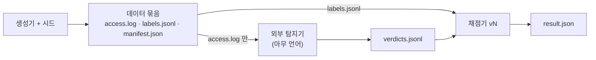

# 탐지기 벤치마크 설계 (초안, 2026-11-19)

> 상태: **설계만** — 아직 구현하지 않았다. 의견은 이슈로.
> 목표: 다른 사람이 자기 탐지 룰 · ML 모델을 이 연습장에 넣고, **같은 데이터 · 같은 채점 기준**으로 성능을 비교한다.
> 한계를 먼저 적는다: 데이터는 **합성 트래픽**(`traffic/lab_traffic.py`)이다. 점수는 "이 생성기 기준"이지 실제 운영 성능이 아니다.

## 1. 지금 구조와 벤치마크에 모자란 것

지금은 하나의 실시간 고리다: `traffic → nginx(access.log) → detector → events.jsonl / ips.map(차단) → scorer`.
탐지기 · 채점기 · 정답지가 이미 나뉘어 있어 뼈대는 있다. 비교용으로 쓰기엔 아래가 모자라다.

| 모자란 것 | 왜 문제인가 | 이 문서의 답 |
|---|---|---|
| 탐지기 입출력이 이 저장소 코드에 묶여 있음 | 외부 탐지기(다른 언어 · 다른 SIEM)가 끼어들 곳이 없다 | §3 입출력 명세 |
| 생성기에 시드가 없음 | 같은 조건으로 다시 돌릴 수 없다 | §4 시드 |
| **공격자 IP 대역이 고정** (정상 10.10 · 탐색 10.66 · BOLA 10.77) | IP 앞자리만 보고 맞히는 탐지기가 만점을 받는다 | §4 IP 무작위화 |
| 탐색 경로 15개 · BOLA 순서가 고정 | 정답을 외운 룰이 이긴다 | §4 변형 |
| 채점 기준에 버전이 없음 | 채점기를 고치면 예전 점수와 비교가 깨진다 | §5 버전 |
| 실시간 10분 실행 필요 | 기여자가 여러 번 돌려 보기 어렵다 | §2 오프라인 트랙 |

## 2. 트랙 두 개

| | 오프라인 트랙 (먼저) | 실시간 트랙 (나중) |
|---|---|---|
| 입력 | 미리 만든 접속 로그 파일 | 지금처럼 살아 있는 nginx 로그 |
| 탐지기 | 파일을 읽고 판정 파일을 쓴다 — **어떤 언어 · 도구든** | 컨테이너로 붙어서 실제로 차단 |
| 재는 것 | 탐지율 · 오탐 · 탐지까지 걸린 시간(로그 시각 기준) · 차단 결정 전 성공한 공격 요청 | 위 + nginx 가 실제로 막기 전 새어 나간 성공 |
| 장점 | 빠르고 재현 쉬움, 외부 참여 쉬움 | 대응까지 포함한 진짜 성능 |



탐지기에는 **access.log 만** 준다. 정답지(labels.jsonl)는 채점기만 본다.

## 3. 입출력 명세

**입력** — nginx combined 형식 한 줄 (지금 `nginx/nginx.conf` 의 `log_format lab` 그대로). 출발지는 첫 칸 — 연습장은 `X-Client-IP` 헤더 값을 쓰고, 없으면 실제 주소(`$remote_addr`).

```
10.10.0.3 - - [19/Nov/2026:03:12:44 +0000] "GET /orders/12 HTTP/1.1" 200 312 "-" "Mozilla/5.0 (api-defense-lab)"
```

**출력** — `verdicts.jsonl`, 판정 하나에 한 줄:

```json
{"t": "2026-11-19T03:12:51+00:00", "ip": "10.77.0.41", "action": "block", "score": 0.91, "reason": "sequential order ids"}
```

| 칸 | 필수 | 뜻 |
|---|---|---|
| `t` | ✅ | 판정 시각 (ISO 8601). 오프라인 트랙에선 **판정 근거가 된 마지막 로그 줄의 시각 이후**여야 한다 — 미래를 본 판정은 무효 |
| `ip` | ✅ | 대상 출발지 |
| `action` | ✅ | `alert`(경보만) 또는 `block`(차단 결정) |
| `score` · `reason` | | 자유. 보고서에 그대로 보인다 |

지금 detector 의 `events.jsonl` 은 `type: alert / ml / block` 이다 → 변환기 하나로 이 형식이 된다 (`alert`·`ml high` → `alert`, `block` → `block`). 이 저장소의 탐지기도 같은 명세로 첫 참가자가 된다.

## 4. 데이터 — 시드 · 무작위화 · 개발용과 채점용

생성기에 `--seed` 를 넣고, 시드 하나가 **시나리오 대본**을 정한다: 누가 언제 무엇을 하는지.
(같은 시드라도 바이트까지 같지는 않다 — 앱이 주는 주문 ID · 응답 시간이 매번 다르다. 같은 것은 대본이다.)

시드가 정하는 것:

| 항목 | 지금 | 바꿀 것 |
|---|---|---|
| IP | 역할마다 고정 대역 | 정상 · 공격 모두 **같은 큰 풀**(예: 10.0.0.0/16)에서 무작위 — 대역으로는 구분 불가 |
| 탐색 경로 | 15개 고정 | 더 큰 목록에서 일부를 무작위로 · 순서 섞기 · 쿼리 변형 |
| BOLA | 1..n 순서대로 0.4초 간격 | 순서 · 건너뛰기 · 섞기 · 빠름/느림 (crAPI 검증에서 쓴 변형 `orders-fast/slow/shuffled` 를 옮겨 옴) |
| 정상 행동 | 20명 · 고정 비율 | 인원 · 비율 · 문서 화면 방문 여부를 흔듦 |
| User-Agent | 모두 같음 | 몇 가지 중 무작위 (UA 하나로 구분 못 하게) |

**개발용과 채점용 분리**

- **개발용 시드**(예: `dev-0001` ~ `dev-0020`): 데이터 묶음과 정답까지 공개. 학습 · 튜닝에 마음대로 쓴다.
- **채점용 시드**: 공개하지 않는다. 결과 표에 올릴 때 메인테이너가 **새 시드**로 데이터를 만들어 다시 돌린다.
- 생성기가 있어서 가능한 방식이다 — 지켜야 할 비공개 테스트 파일이 따로 없고, 외워서 맞출 데이터 자체가 없다.

데이터 묶음 `datasets/<시드>/`: `access.log` · `labels.jsonl` · `manifest.json`(생성기 버전 · 시드 · 앱 이미지 digest · 만든 시각).

## 5. 채점 기준 (scorer v1 로 고정)

행위자(정답지의 IP 하나 × 실행 하나) 단위. 지금 `scorer/score.py` 의 정의를 그대로 가져온다.

| 지표 | 대상 | 정의 |
|---|---|---|
| 탐지율 | 공격 행위자 | 행위 구간(+60초 유예) 안에 `alert` 또는 `block` 이 하나라도 있으면 탐지 |
| 차단율 | 공격 행위자 | 같은 구간 안에 `block` |
| 탐지까지 · 차단 결정까지 (중앙값, 초) | 공격 행위자 | 그 IP 첫 요청부터 첫 판정까지 |
| 차단 전 성공 | 공격 행위자 | 첫 `block` 시각 전에 받은 2xx (가입 · 로그인 제외). 오프라인 트랙의 "새어 나간 공격" |
| 오탐 경보 IP · 오탐 차단 IP | 정상 행위자 | `alert` · `block` 을 받은 정상 IP 수 / 전체 |

- 시나리오별(탐색 · BOLA · 변형별)로 따로 보고, **하나로 합친 점수는 만들지 않는다** — 합치는 가중치가 곧 의견이라서. 대신 "오탐 차단 0 을 지키면서 탐지율"을 대표 칸으로 둔다.
- 모든 결과에 `scorer_version` · `dataset_version` 을 찍는다. **버전이 다르면 같은 표에 올리지 않는다.**
- 채점기를 바꾸면 버전을 올리고, 결과 표의 기존 항목은 메인테이너가 새 버전으로 다시 채점한다.

## 6. 참가 규칙

1. 탐지기는 `access.log` 만 읽는다. 정답지 · 생성기 시드 · 생성기 코드 안의 경로 목록을 판정에 쓰면 안 된다.
2. 학습 · 튜닝은 개발용 시드로만.
3. 결과 표에 올리려면 **재현할 수 있어야 한다**: 탐지기 코드(또는 컨테이너 이미지)와 실행 명령을 공개.
4. 사용한 외부 데이터 · 사전 학습 모델이 있으면 밝힌다.

## 7. 제출과 결과 비교 — 처음엔 사람이 확인

```
results/<참가자>-<탐지기>/
  result.json      채점기가 만든 그대로 (scorer_version · dataset_version 포함)
  README.md        탐지기 설명 · 실행 명령 · 코드/이미지 위치
```

PR 로 낸다 → 메인테이너가 채점용 새 시드로 다시 돌려 확인 → `RESULTS.md` 표에 올린다.

**PR 에서 참가자 코드를 자동으로 실행하지 않는다.** 남의 코드를 이 저장소의 GitHub Actions 안에서 돌리면 워크플로 권한 · 토큰이 위험해진다 (특히 `pull_request_target`). 참가자가 늘어 자동 채점이 필요해지면 그때 따로 설계한다: `pull_request`(비밀값 없음 · 읽기 전용 토큰) · 네트워크 끊은 컨테이너(`--network none`) · CPU · 메모리 · 시간 제한 · 결과 파일만 꺼내기.

## 8. 구현 순서 (아직 안 함)

| 순서 | 일 | 크기 |
|---|---|---|
| 1 | 생성기: `--seed` · IP 풀 · 탐색/BOLA/정상 변형 · UA | 중 |
| 2 | 데이터 묶음 만들기 명령 + 개발용 시드 몇 개 공개 | 중 |
| 3 | `verdicts.jsonl` 명세 검사기 · `events.jsonl` 변환기 | 소 |
| 4 | 채점기 오프라인 모드 (`--verdicts` · `--dataset`) · 버전 표기 | 중 |
| 5 | 예제 외부 탐지기 1개 (예: 표준 라이브러리만 쓴 빈도 룰) | 소 |
| 6 | `results/` · `RESULTS.md` · 기여 절차 (CONTRIBUTING) | 소 |
| 7 | 실시간 트랙 | 나중 |

## 9. 열려 있는 질문

- 오프라인 트랙의 "판정 시각"을 참가자가 정직하게 적는지 어떻게 확인하나? — 로그를 한 줄씩 흘려주고 판정을 받는 실행기(채점용)를 두면 미래를 볼 수 없다. 처음엔 규칙 + 메인테이너 재실행으로.
- DVRA 하나에만 맞춘 탐지기가 이기는 문제 — 앱을 하나 더(예: crAPI) 넣을지.
- 실제 운영 로그를 익명화해 넣을 수 있는 기여자가 생기면 합성 데이터와 따로 표를 둔다.
